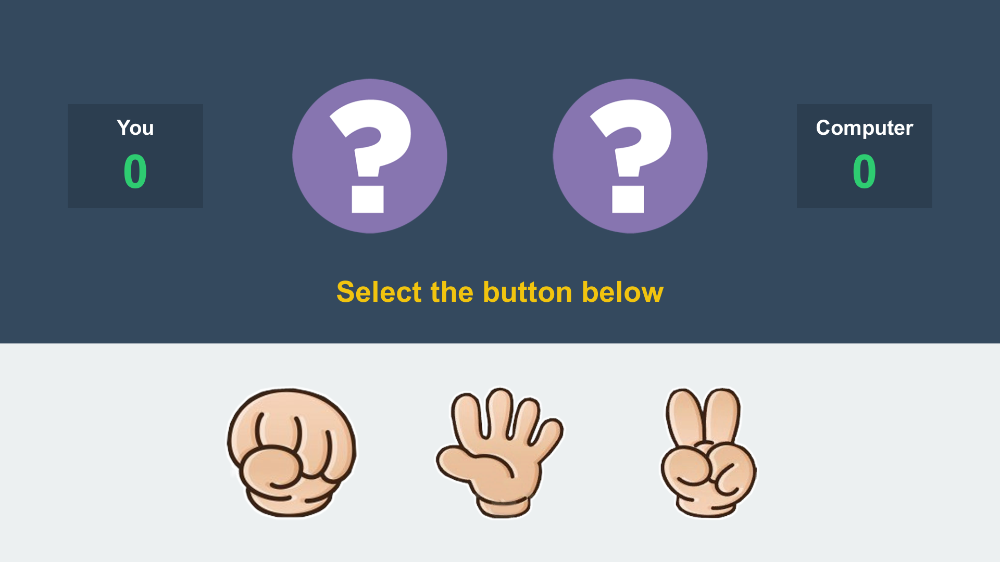

# Rock-Paper-Scissors

A simple 2D Rock-Paper-Scissors game made with Unity.

The game opens on a menu page. Select **Play** to enter the match, choose rock, paper, or scissors, and compete against a random computer choice.



## Features

- Menu screen with Play and Quit buttons
- Rock, paper, and scissors choices
- Random opponent choices
- Win, loss, and draw results
- Player and computer score counters
- Return-to-menu button
- Keyboard controls
- Animated result text

## How to Play

1. Open the project in Unity.
2. Open `Assets/Scenes/MenuScene.unity`.
3. Press **Play** in the Unity Editor.
4. Select **Play** on the menu.
5. Choose:
   - Rock
   - Paper
   - Scissors

The result and scores update after every round.

### Controls

| Action | Mouse | Keyboard |
|---|---|---|
| Choose rock | Rock button | `1` |
| Choose paper | Paper button | `2` |
| Choose scissors | Scissors button | `3` |
| Return to menu | Menu button | - |

### Rules

| Player choice | Computer choice | Result |
|---|---|---|
| Rock | Scissors | Win |
| Paper | Rock | Win |
| Scissors | Paper | Win |
| Same choice | Same choice | Draw |
| Any other combination | - | Loss |

## Project Structure

```text
Assets/
  Editor/
    BuildRPSScene.cs
  Resources/
    img_1.png
    img_2.png
    img_3.png
    img_4.png
  Scenes/
    MenuScene.unity
    GameScene.unity
  Scripts/
    MenuController.cs
    GameController.cs
```

## Main Scripts

- `MenuController.cs` loads the game scene and handles the Quit button.
- `GameController.cs` handles player choices, computer choices, scores, results, and the return-to-menu action.
- `BuildRPSScene.cs` generates both scenes and sets the menu as the first scene.

## Requirements

- Unity 6.3 LTS
- Unity 2D project support
- uGUI package
